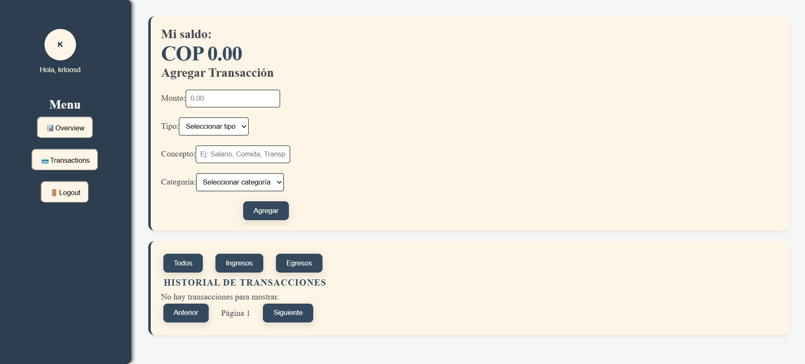

# 💰 WealthWise Dashboard

**WealthWise Dashboard** es una aplicación web de gestión financiera personal diseñada para llevar un control claro, dinámico e intuitivo de ingresos y egresos en tiempo real.

[🚀 Ver Demo en Vivo]([suspicious link removed]) | [📂 Código en GitHub](https://github.com/Krlosd96/proyectoFinalNotebook.git)

---

## 📸 Vista Previa

![WealthWise Dashboard Preview]

---

## ✨ Características Principales

- **Resumen Financiero Dinámico:** Cálculo automático en tiempo real del saldo total, ingresos acumulados y gastos totales.
- **Formateo de Moneda Profesional:** Internacionalización de valores monetarios utilizando la API nativa `Intl.NumberFormat` (formato dinámico con decimales y separadores de miles).
- **Gestión Completa de Transacciones (CRUD):**
  - **Creación:** Formulario agrupado en columna con validaciones estrictas para evitar montos negativos o descripciones vacías.
  - **Eliminación:** Borrado individual de transacciones mediante inmutabilidad de estado (`.filter()`) y actualización inmediata del balance.
- **Persistencia de Datos:** Integración con `localStorage` del navegador para conservar la información al recargar la página.
- **Interfaz Amigable (UX):** Mensajes informativos de estado vacío (_Empty State_) y diseño adaptativo estructurado con CSS Flexbox.

---

## 🛠️ Tecnologías Utilizadas

- **Frontend:** [React]([suspicious link removed]) (Hooks: `useState`, `useEffect`)
- **Lenguaje:** JavaScript (ES6+)
- **Estilos:** CSS3 (Layouts en columna y fila con Flexbox)
- **Herramientas:** Vite / Create React App, Git, GitHub
- **Despliegue:** Vercel / Netlify

---

## 🚀 Instalación y Configuración Local

Si deseas ejecutar este proyecto en tu máquina local, sigue estos pasos:

1. **Clona el repositorio:**
   ```bash
   git clone [suspicious link removed]
   ```

## Autor

Carlos David Sevilla Duarte
Github: Krloosd96
